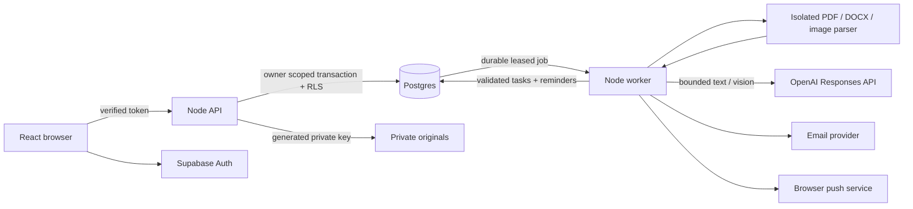

# Architecture and operational behavior

## Data flow

React/Vite and Express use one origin. Only explicitly public Supabase/VAPID configuration reaches the client. Local development runs Express, Vite and the worker in one process, with persisted PGlite and private filesystem originals. Hosted mode uses a separate Node worker and Supabase PostgreSQL/Storage. All authoritative jobs and schedules live in PostgreSQL, not in browser timers. The browser's five-second refresh only updates visible state.

## Ownership and access

- Every application table has forced row-level security for `lifeadmin_user`. All user-facing repository transactions set this restricted role and a transaction-local `app.user_id` **after** verifying the Supabase user token. Data access also uses generated IDs and contextual checks. Client-supplied user IDs are never accepted.
- Foreign keys bind task/document/job/reminder owner relationships. Upload uniqueness is scoped to `(user_id, hash)`. Push endpoints cannot be reassigned across users by an upsert; RLS rejects it.
- Queue claims are privileged worker operations. Processing and committing a claimed item return to the item owner's RLS scope. The backend DB connection can access all users when used for queue maintenance; it must stay secret and trusted.
- Supabase Storage has no browser grants for the dedicated private bucket. The backend enforces document RLS before getting bytes with its service key. Storage paths are exactly `user-uuid/document-uuid`; the adapter validates the owner prefix and UUID structure. Public originals and permanent share URLs are not generated.
- Original downloads are authenticated responses, `Cache-Control: no-store`, `Content-Disposition: attachment`, correct detected MIME, and `nosniff`. Image previews use an authenticated fetch to a revocable browser blob URL. PDFs/DOCX are downloaded rather than embedded as executable browser content.
- Production rejects development adapters and requires HTTPS origin, real DB and Supabase credentials. Development binds to loopback, checks Host/remote address, and uses unmistakable demo identity headers; those headers are ignored in production. Cross-origin API requests are rejected. No production password simulation exists.
- Passwords and OAuth secrets remain with Supabase. The API requires verified email and uses `getUser`, not a client-supplied session object, as the authority. Browser sessions use the maintained Supabase SDK with PKCE and refresh.

## Ingestion boundaries

| Limit              | Enforced value                                                                                                                                     |
| ------------------ | -------------------------------------------------------------------------------------------------------------------------------------------------- |
| Upload             | One file/request; 8 MiB; authenticated; 20 attempts/user/UTC day                                                                                   |
| Retained documents | 500 per user; duplicates do not consume another slot                                                                                               |
| PDF                | At most 10 pages; password-protected/corrupt files fail                                                                                            |
| Images             | PNG/JPEG decoded content; single frame; 16 million pixels; 6000 pixels per side                                                                    |
| Vision raster      | At most 1800 pixels on longest side; PDF render at most 3.3 million pixels/page                                                                    |
| DOCX               | At most 250 ZIP entries; total declared/decompressed size 12 MiB; compression-ratio checks; no macros/encrypted ZIP/DTD/entities                   |
| Extracted text     | At most 40,000 characters total; at most 400 source sections                                                                                       |
| Parser             | Separate child; 256 MB JS heap; 25-second wall timeout; 45 MB output bound; minimal environment without app secrets                                |
| Extraction         | 30 attempts/user/UTC day; 3 total attempts/document; 180-second outer deadline; individual API requests 45 seconds; SDK automatic retries disabled |
| Model usage        | At most 10 image transcriptions + one extraction per attempt; 3000 output tokens/transcription, 6000/extraction; at most 30 tasks                  |
| Push               | At most 10 subscriptions/user; trusted HTTPS push-provider endpoints only; 10-second send timeout                                                  |
| SQL                | Parameterized values; production statement timeout 30 seconds; connection timeout 15 seconds                                                       |

Magic bytes determine type; full parsing validates structure before storage. ZIP validation is not merely an extension test. XML syntax is checked and DTD/entity declarations rejected; built-in character escaping is decoded. PDF.js is configured without evaluation, external font resources or document-provided resource fetching. Native canvas/sharp process only bounded rasters. The JavaScript heap limit is not a full OS-level native-memory sandbox; large/adversarial PDFs may still require stronger container isolation for hostile public-scale operation. The worker never executes document macros, follows hyperlinks, or gives the model tools.

Ordinary PDFs use PDF.js text with page references. Pages with raster images or little text are rendered for vision transcription. Screenshots are decoded and normalized before transcription. DOCX body paragraphs and table rows carry stable paragraph/table references, never invented page numbers. Headers, footers, footnotes, text boxes and complex Word layouts are outside the current parser's body-text scope; inspect originals for omitted material.

## Extraction and evidence

The model receives high-priority extraction rules and a separate untrusted source payload. Strict structured output includes obligation status, category, explicit date/time/evidence, amount/currency, organization and uncertainties. Refused, incomplete or invalid schema output is rejected; no unvalidated tasks are created. Paid/completed/historical/example candidates are excluded. Additional validation rejects unmatched source IDs/excerpts, unverifiable date/time/currency/amount fields, and obvious paid-receipt excerpts.

Explicit ISO dates, English month-name dates, and unambiguous numeric dates are validated. Relative day offsets require an explicit matching reference-date excerpt in the same source. Missing years, ambiguous numeric dates, unresolved timezone abbreviations and invalid/repeated DST appointment times are not guessed. Conservative rules can flag valid non-English or unusual date formats for manual editing. A user can resolve attention flags in the edit form; this is not an approval step for ordinary extraction.

Image evidence is matched against the **AI transcription**, not independently verified OCR. Both transcription and interpretation can be wrong. Supporting text can be copied correctly but misinterpreted, including malicious instructions disguised as obligations. The application has no autonomous payment, link-following, email-composition or arbitrary action tools, and notification previews contain no document details. Model prompt-injection robustness has not been established by synthetic unit tests. Inspect original sources for consequential obligations.

## Durable processing and idempotency

Uploads first create a staging row with a generated private key, then store the original and activate the extraction job. A failed store schedules durable cleanup. Abandoned staging older than 10 minutes is reclaimed for cleanup. Duplicate bytes within a user return the existing document, without a second extraction job or task set.

Workers atomically claim one job using `FOR UPDATE SKIP LOCKED`, a five-minute lease and a unique lease token. All completion/error writes require that token, so a reclaimed stale worker cannot commit output. Transient provider 429/5xx failures retry after two minutes within the three-attempt budget. Other failures remain visible for user-triggered retry. The queue survives process restarts; there is no requirement for a browser to be open.

Task creation, reminder creation and job completion share a database transaction. Task fingerprints and unique constraints prevent repeated commits. Once an extraction has produced any tasks, **retries preserve the existing task set and supporting sources**, including edits, completion/dismissal and deletion tombstones; they do not add differently worded model variants. This conservative policy avoids duplicate/reappearing obligations. Limitation: a partial successful extraction retry does not automatically append missed obligations to an existing task set. Inspect the source and edit tasks; a future reviewable reconciliation UI would be needed for safe additive re-extraction. Failed runs with zero tasks can retry normally.

Task deletion leaves a hidden tombstone while its document remains, preventing resurrection. Document deletion immediately removes tasks/reminders/jobs and erases source text in the application record, marks the document unavailable, and enqueues private-object cleanup. Cleanup failures retry every 10 minutes indefinitely (monitor these). After success the remaining document/job record is removed. Active workers cannot recreate a deleted document's tasks. A download already in progress or accepted notification cannot be recalled.

## Reminder semantics

- Users explicitly confirm their timezone. Date-only reminders default to 09:00 on the previous local calendar day and due date. The timezone's daylight-saving offsets apply separately to each day.
- Timed appointments use the explicit appointment timezone and exactly 24 hours before, then the appointment instant. The timeline converts those instants to the viewer's profile timezone. Ambiguous or nonexistent local times remain unscheduled.
- Preferences allow 0–14 lead days and any whole local reminder hour. A zero-day lead coalesces with the due reminder. Appointment leads mean the chosen number × 24 elapsed hours.
- Attention flags, missing dates, unconfirmed onboarding, completed/dismissed/deleted tasks or disabled channels produce no new reminders.
- Slots already past when a task is created or edited are skipped. No catch-up burst is sent; overdue tasks remain in the app. On worker recovery, slots over one hour late expire. Remaining due slots may be sent within that one-hour grace period. A generic in-app activity row explains expiration.
- Task edits, completion, reopening and timezone/channel preferences transactionally cancel pending reminders and create a new task revision's future reminders. Accepted reminders remain as history. Profile locks serialize sending with edits/deletion; an already in-flight provider send may complete before the mutation takes effect.
- Reminder claims use leases and tokens. Retries are bounded to three actual provider attempts, five minutes apart and inside the one-hour grace period. Missing configuration or denied development destination is recorded as **blocked** and checked later, not delivered.
- Resend receives a stable reminder ID as its idempotency key. Web Push records accepted subscriptions to avoid resending them on ordinary partial retries. A crash between provider acceptance and database commit can still cause a push repeat; the service worker uses a stable notification tag, but exactly-once external delivery is not guaranteed.
- Statuses: scheduled, processing, blocked, accepted, failed, expired, cancelled, skipped. **Accepted means provider acknowledged the request**. No delivered/read claim is made. Synthetic tasks are skipped before external delivery.

## Privacy and retention

Before upload the user sees that document text/images go to OpenAI, private storage/account data to Supabase in hosted mode, and processing to Render. Reminder email goes to Resend and recipient email infrastructure. Web push subscription capabilities and generic encrypted payloads use the browser's push vendor. Google processes identity for Google sign-in. Fonts are bundled locally; there are no analytics trackers or external font requests.

Originals, extracted text, tasks, profiles and activity stay in the selected database/storage until user deletion or operator retention action. There is no automatic archival/retention timer. Task tombstones remain until document deletion; daily usage totals remain for abuse accounting and contain no raw document content. Push subscriptions persist until removal or expiry. Document cleanup is eventually retried when providers recover.

Application logs intentionally exclude raw documents, model output, tokens, credentials and subscription endpoints. Provider-side logs/backups/abuse monitoring may persist under provider terms; `store:false` is not a promise of zero retention. Deleting application data does not purge downloaded copies, email already sent, displayed push notifications or provider backups. Production operators must establish a backup lifecycle, account-deletion procedure and legally appropriate privacy policy for their use case. No regulatory compliance certification is claimed.

The local adapter stores data on disk without application-level encryption; use OS disk encryption/access controls and synthetic examples for development. Production encryption depends on the configured managed providers and deployment. All hosted connections should use verified TLS.
